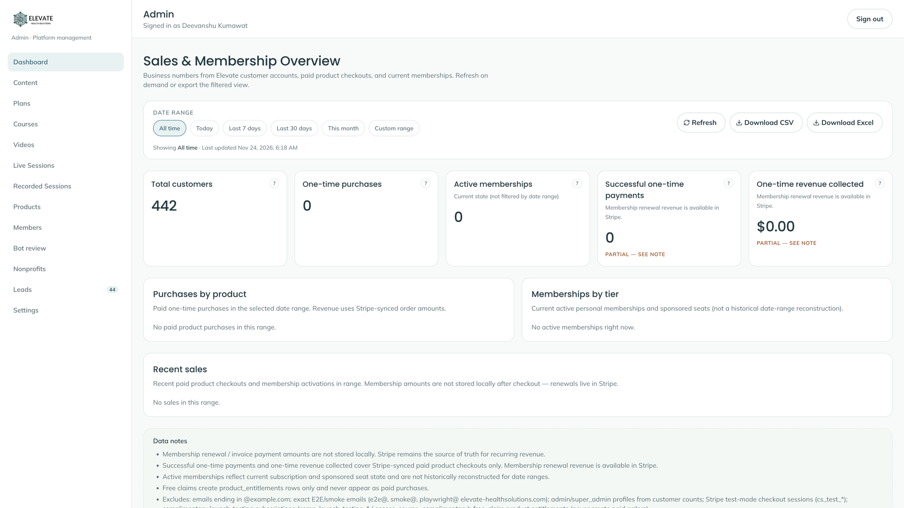
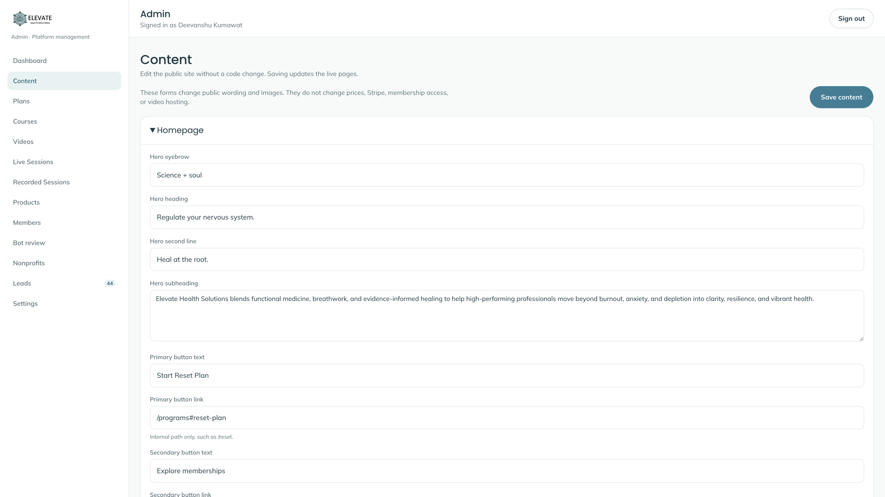
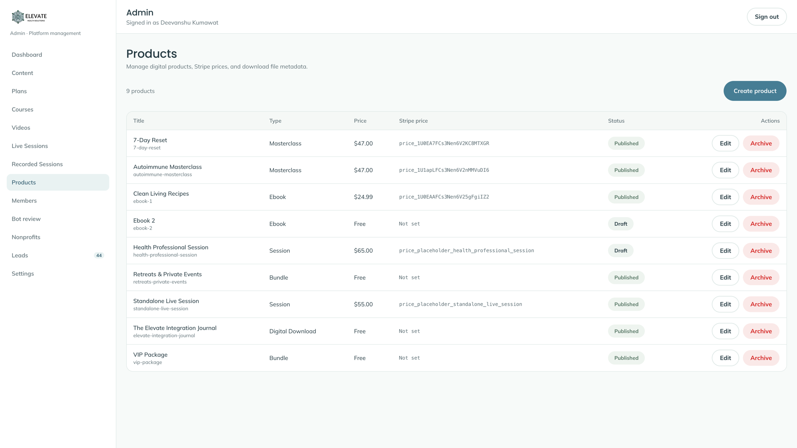

# Screenshot guide

A picture walkthrough of the admin for https://elevate-healthsolutions.com. It replaces the Loom for day-to-day tasks. The full written guide is `docs/OPERATOR_GUIDE.md`.

Screenshots were taken on production on 24 Nov 2026. Members and Leads are not pictured because they show customer details.

## 1. Sign in

Open https://elevate-healthsolutions.com/login?next=%2Fadmin and sign in. If the password is not accepted, use https://elevate-healthsolutions.com/forgot-password with the same email.

## 2. Dashboard: sales and memberships

- The date buttons filter one-time sales. Active memberships and monthly recurring revenue always show the current state.
- Monthly recurring revenue is an estimate from current subscription prices, with yearly plans divided by 12. Collected renewals are in Stripe.
- Download CSV or Excel exports the filtered view.
- Free claims, complimentary Reset access, $0 promo-code orders, and admin accounts are not counted as revenue.

## 3. Content: homepage and site text

- Each section (Homepage, About, Membership copy, Retreats, Nonprofit, Testimonials, Footer) opens and closes.
- Button links must be site paths such as `/reset`.
- Image uploads accept JPEG, PNG, WebP, or GIF up to 5 MB, with alt text. Sizes are in `docs/MEDIA_SPECS.md`.
- Press **Save content**, then refresh the public page to check it.
- Membership copy changes wording only. It does not change price or what a plan unlocks.

## 4. Products and PDFs

- **Edit** changes title, description, image, PDF, and publish state.
- The price comes from the linked Stripe price. Typing a different number here does not change what Stripe charges.
- PDFs are PDF only, up to 50 MB, and are stored privately. Buyers see them under Downloads.

## 5. Promo codes (Stripe)

Product checkout, including the $47 Reset, has a "Add promotion code" field on the Stripe payment page.

1. In Stripe, open **Product catalog → Coupons** and create a coupon (percent or amount off).
2. Add a **promotion code** to it, for example `TESTIMONIAL100`.
3. Optional limits in the promotion code settings: first-time customers only, a maximum number of redemptions, and an expiration date. Use these for corporate or testimonial codes.
4. Share the code. The customer types it on the Stripe page.

A 100%-off code still creates an order and grants access after Stripe confirms it. It shows as a $0 order and does not count toward revenue. Membership checkout does not accept promo codes.

## 6. Courses and lessons

Admin → Courses lists each course. Open one to edit modules and lessons, reorder them, and switch draft or published. Members only see published lessons they are entitled to.

## 7. Recorded and live sessions

- Admin → Recorded Sessions: add a recording, attach the Mux video, publish. A file only in Google Drive does not publish. See `docs/RECORDED_SESSION_WORKFLOW.md`.
- Admin → Live Sessions: title, description, start time, Zoom links, the trial checkbox, publish. The $55 Live Breathwork purchase opens only when a published trial session has a real future date.

## 8. Complimentary Reset access

Admin → Members has a Complimentary Reset form. Enter the member's email and grant. It gives Reset access without a Stripe order. Revoke removes only that grant.

## 9. Who has admin

Accounts with the `super_admin` role can open every published course, video, download, and recording without buying. Everyone else needs a purchase, subscription, or complimentary grant.
